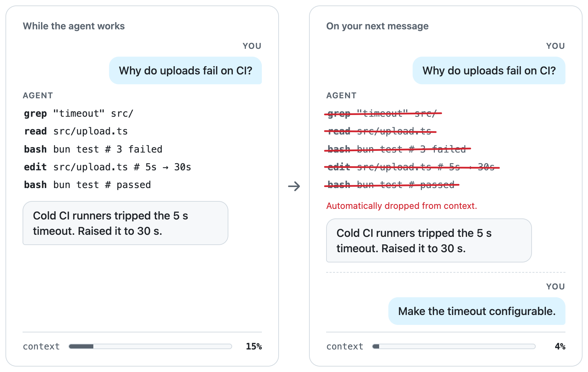

<div align="center">
<h1>agent fold</h1>
<span>A plugin for coding agents to keep the main context a clean thread of decisions, with detail in artifacts.</span>
</div>

## How a run works

<picture>
  <source media="(prefers-color-scheme: dark)" srcset="docs/how-a-run-works/dark.png">
  
</picture>

1. A run starts at your message and ends at the agent's final reply. Before that reply, the agent records what the reply leaves out in `INDEX.md` and notes under `~/.agent-fold`.
2. When the next run starts, the earlier run keeps your messages and its final reply. Its tool calls fold away. The new run gets a snapshot of `INDEX.md`.
3. The agent reads a note back only when it needs the detail.

## Install

### Oh My Pi

```sh
omp plugin marketplace add 5u4/agent-fold
omp plugin install agent-fold@agent-fold
```

Restart omp to load the plugin.

#### Uninstall

```sh
omp plugin uninstall agent-fold@agent-fold
omp plugin marketplace remove agent-fold
```

### GitHub Copilot CLI and app

```sh
git clone https://github.com/5u4/agent-fold.git
cd agent-fold/copilot && bun link
copilot plugin marketplace add ..
copilot plugin install agent-fold@agent-fold
```

Start Copilot through `agent-fold`:

```sh
agent-fold copilot --experimental
agent-fold gh-app
```

#### Uninstall

```sh
copilot plugin uninstall agent-fold@agent-fold
copilot plugin marketplace remove agent-fold
cd agent-fold/copilot && bun unlink
```
